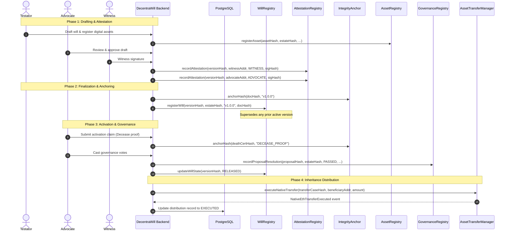

# DecentraWill Smart Contracts Documentation

## 1. Executive Summary & Design Philosophy

DecentraWill integrates traditional legal estate planning with cryptographic trust guarantees. The smart contract suite is deployed on EVM-compatible networks (Ethereum Sepolia / Mainnet) to serve as a **tamper-evident cryptographic anchor and execution coordinator**, not a monolithic replacement for the legal system.

### Core Principles
1. **Zero On-Chain PII / Plaintext**: Raw wills, identity documents, private keys, medical certificates, and personally identifiable information (PII) are **never** stored on-chain. Only cryptographic hashes (SHA-256, Keccak-256), state machine flags, and timestamps are anchored.
2. **Tiered Source of Truth**:
   - **PostgreSQL**: Authoritative for transactional application state, role-based access control, workflow orchestration, and audit logs.
   - **Encrypted Object Vault**: Authoritative for envelope-encrypted document payloads (AES-256-GCM with KMS-managed DEKs).
   - **Smart Contracts (EVM)**: Authoritative for non-repudiation, tamper-evident proofs, lifecycle milestones, and on-chain digital asset transfers.
3. **Minimalist & Auditable**: Contracts follow strict separation of concerns, minimalist storage footprints, explicit state transitions, and replay protection.

---

## 2. Smart Contract Inventory

| Contract | File | Primary Responsibility |
|---|---|---|
| [`WillRegistry`](file:///home/attacker/Desktop/decentraWill/contracts/WillRegistry.sol) | `contracts/WillRegistry.sol` | Authoritative on-chain lifecycle state machine and version index for wills. |
| [`IntegrityAnchor`](file:///home/attacker/Desktop/decentraWill/contracts/IntegrityAnchor.sol) | `contracts/IntegrityAnchor.sol` | Generic immutable cryptographic timestamping and existence proofs for documents/events. |
| [`AttestationRegistry`](file:///home/attacker/Desktop/decentraWill/contracts/AttestationRegistry.sol) | `contracts/AttestationRegistry.sol` | Non-repudiation registry for testator, witness, advocate, and executor digital signatures. |
| [`AssetRegistry`](file:///home/attacker/Desktop/decentraWill/contracts/AssetRegistry.sol) | `contracts/AssetRegistry.sol` | Identity and metadata registry for estate blockchain-native assets (tokens, NFTs). |
| [`GovernanceRegistry`](file:///home/attacker/Desktop/decentraWill/contracts/GovernanceRegistry.sol) | `contracts/GovernanceRegistry.sol` | Tamper-proof anchor for multi-executor and advocate voting resolutions and dispute outcomes. |
| [`AssetTransferManager`](file:///home/attacker/Desktop/decentraWill/contracts/AssetTransferManager.sol) | `contracts/AssetTransferManager.sol` | Replay-protected, authorized executor for on-chain inheritance distributions. |

---

## 3. Detailed Contract Analysis

### 3.1. `WillRegistry` ([WillRegistry.sol](file:///home/attacker/Desktop/decentraWill/contracts/WillRegistry.sol))

#### The Need
In inheritance law, the doctrine of revocation dictates that a newer, validly executed will supersedes all prior wills. Disputes frequently arise over whether a submitted will is the testator's final testament or an obsolete draft. 

`WillRegistry` creates a tamper-evident on-chain timeline of will versions for every registered estate:
- Links an estate identifier (`estateHash`) to its current active version (`versionHash`).
- Enforces automatic version supersession: registering a new version transitions the prior active version to `SUPERSEDED`.
- Provides an unalterable trail of state transitions (`DRAFT` → `ACTIVE` → `SUPERSEDED` → `ACTIVATION_PENDING` → `RELEASED` → `CLOSED` → `ARCHIVED`).

#### Data Structure
- `WillState`: Enum defining the will lifecycle: `[DRAFT, ACTIVE, SUPERSEDED, ACTIVATION_PENDING, RELEASED, CLOSED, ARCHIVED]`.
- `WillRecord`:
  - `estateHash`: Hash identifying the overarching estate.
  - `versionRef`: Semantic version string (e.g., `"v1.0.0"`).
  - `documentHash`: SHA-256 hash of the final legal will PDF/artifact.
  - `state`: Current `WillState`.
  - `timestamp`: Block timestamp of registration.
  - `registeredBy`: Relayer address that anchored the transaction.

#### Key Functions
- `registerWill(bytes32 versionHash, bytes32 estateHash, string versionRef, bytes32 documentHash)`: Registers a new active will version; automatically marks any previous active version as `SUPERSEDED`.
- `updateWillState(bytes32 versionHash, WillState newState)`: Updates the lifecycle state (e.g., during probate or activation).
- `getWill(bytes32 versionHash)`: Public view function returning the complete `WillRecord`.

---

### 3.2. `IntegrityAnchor` ([IntegrityAnchor.sol](file:///home/attacker/Desktop/decentraWill/contracts/IntegrityAnchor.sol))

#### The Need
Estate files contain multiple supplementary legal exhibits, medical fitness certificates, amendments (codicils), and audit log summaries. Building dedicated lifecycle logic for every auxiliary file creates unnecessary contract complexity.

`IntegrityAnchor` acts as a lightweight, generic proof-of-existence engine:
- Proves that a specific document or event hash existed at an exact point in time.
- Guarantees immutability: once anchored, a document hash can never be overwritten (`require(anchors[docHash].timestamp == 0)`).
- Allows any court, advocate, or beneficiary to independently verify that an off-chain document is identical to the one originally anchored.

#### Data Structure
- `Anchor`:
  - `docHash`: Cryptographic hash (SHA-256 / Keccak-256) of the document or data snapshot.
  - `versionRef`: Reference tag or document identifier.
  - `timestamp`: Block timestamp when anchored.
  - `anchoredBy`: Transaction sender.

#### Key Functions
- `anchorHash(bytes32 docHash, string versionRef)`: Immutably records the document hash.
- `verifyHash(bytes32 docHash)`: Public read-only helper returning `(bool exists, uint256 timestamp, string versionRef)`.

---

### 3.3. `AttestationRegistry` ([AttestationRegistry.sol](file:///home/attacker/Desktop/decentraWill/contracts/AttestationRegistry.sol))

#### The Need
Under traditional legal frameworks (e.g., the Indian Succession Act, UK Wills Act, US Uniform Probate Code), a will is invalid without required signatures from the testator, attesting witnesses, and often a legal advocate. In probate litigation, witnesses or heirs may dispute whether an attestation actually took place.

`AttestationRegistry` provides non-repudiation for all digital signing events:
- Stores cryptographic proofs of digital signatures linked to a specific will version.
- Distinguishes participant roles via `AttestationType` (`TESTATOR`, `ADVOCATE`, `WITNESS`, `EXECUTOR`).
- Prevents duplicate attestations using composite keys (`keccak256(versionHash, attestor, attestationType)`).

#### Data Structure
- `AttestationType`: Role enum `[ADVOCATE, WITNESS, EXECUTOR, TESTATOR]`.
- `Attestation`:
  - `versionHash`: Targeted will version.
  - `attestor`: Ethereum address or public key representation of the signer.
  - `attestationType`: Role of the attestor.
  - `signatureHash`: Hash of the cryptographic signature payload.
  - `timestamp`: Block timestamp of attestation.

#### Key Functions
- `recordAttestation(bytes32 versionHash, address attestor, AttestationType attestationType, bytes32 signatureHash)`: Records the attestation proof.
- `verifyAttestation(bytes32 attestationId)`: Verifies whether an attestation exists for a given composite ID.

---

### 3.4. `AssetRegistry` ([AssetRegistry.sol](file:///home/attacker/Desktop/decentraWill/contracts/AssetRegistry.sol))

#### The Need
A significant challenge in modern estate planning is the inheritance of blockchain-native assets (cryptocurrencies, NFTs, liquidity tokens). Traditional wills often omit them or expose private keys dangerously.

`AssetRegistry` maintains an on-chain catalog of digital estate assets without exposing secret access details:
- Registers the asset type (`NATIVE_ETH`, `ERC20`, `ERC721`, `ERC1155`, `CUSTOM`).
- Links each asset to the overarching estate identifier (`estateHash`).
- References off-chain encrypted asset records and instructions via `metadataHash`.
- Prevents duplicate registration of the same asset hash.

#### Data Structure
- `AssetType`: Enum `[NATIVE_ETH, ERC20, ERC721, ERC1155, CUSTOM]`.
- `AssetRecord`:
  - `estateHash`: Estate to which the asset belongs.
  - `assetType`: Type of digital asset.
  - `tokenAddress`: Smart contract address of the token (or `address(0)` for native ETH).
  - `tokenId`: Token identifier (for ERC-721 / ERC-1155).
  - `metadataHash`: Hash of the encrypted off-chain inventory item and distribution rules.
  - `registeredAt`: Registration timestamp.

#### Key Functions
- `registerAsset(bytes32 assetHash, bytes32 estateHash, AssetType assetType, address tokenAddress, uint256 tokenId, bytes32 metadataHash)`: Records a digital asset reference under the estate.
- `getAsset(bytes32 assetHash)`: Retrieves asset specifications.

---

### 3.5. `GovernanceRegistry` ([GovernanceRegistry.sol](file:///home/attacker/Desktop/decentraWill/contracts/GovernanceRegistry.sol))

#### The Need
Estates with multiple executors, co-trustees, or legal advocates require collective decision-making (e.g., approving an activation claim, certifying death certificates, or resolving disputed allocations). Without an unalterable voting record, rogue actors could claim unauthorized approval.

`GovernanceRegistry` anchors decision proofs and voting tallies for estate workflows:
- Records the conclusion of estate governance votes (`votesFor`, `votesAgainst`, `state`).
- Anchors the cryptographic `resolutionHash` representing the certified minutes, legal orders, or distribution decisions.
- Prevents post-facto modification or re-adjudication of finalized decisions.

#### Data Structure
- `ProposalState`: Enum `[PENDING, PASSED, REJECTED, EXECUTED]`.
- `ProposalRecord`:
  - `proposalHash`: Unique proposal identifier.
  - `estateHash`: Target estate.
  - `state`: Final resolution status.
  - `votesFor`: Count of affirmative votes.
  - `votesAgainst`: Count of dissenting votes.
  - `concludedAt`: Timestamp of voting closure.
  - `resolutionHash`: Cryptographic hash of the resolution document.

#### Key Functions
- `recordProposalResolution(bytes32 proposalHash, bytes32 estateHash, ProposalState state, uint32 votesFor, uint32 votesAgainst, bytes32 resolutionHash)`: Immutably records the outcome of an estate governance vote.
- `getProposal(bytes32 proposalHash)`: Retrieves proposal details and tallies.

---

### 3.6. `AssetTransferManager` ([AssetTransferManager.sol](file:///home/attacker/Desktop/decentraWill/contracts/AssetTransferManager.sol))

#### The Need
Once all estate conditions are satisfied (testator decease verified, grace periods completed, governance approval passed), digital assets must be disbursed to designated beneficiaries without relying on a single custodial intermediary.

`AssetTransferManager` provides a policy-gated execution pathway:
- Operates under strict platform-relayed controls (`onlyOwner`).
- Replay Protection: Employs an `executedCases` mapping to prevent double-spending or re-execution of transfer cases.
- Direct Transfer: Capable of securely transferring contract-held Native ETH directly to the beneficiary's wallet.
- Audit Trail: Emits structured on-chain events (`TransferExecuted`, `NativeEthTransferExecuted`) that can be reconciled by backend outbox workers.
- **Scope Boundary**: Restricted exclusively to programmatic blockchain-native transfers. Physical assets (real estate, personal belongings) continue to be handled through conventional legal conveyance instruments.

#### Data Structure
- `TransferState`: Enum `[SUBMITTED, EXECUTED, CANCELLED]`.
- `TransferRecord`:
  - `transferCaseHash`: Unique hash of the distribution decision case.
  - `token`: Token contract address (or `address(0)` for ETH).
  - `from`: Originating address.
  - `to`: Beneficiary address.
  - `amount`: Token/Wei amount transferred.
  - `state`: Current transfer state.
  - `timestamp`: Execution timestamp.

#### Key Functions
- `executeNativeTransfer(bytes32 transferCaseHash, address payable to, uint256 amount)`: Executes an ETH payout to the beneficiary, recording the case to prevent replay.
- `recordTransferExecution(bytes32 transferCaseHash, address token, address from, address to, uint256 amount)`: Records on-chain execution proof for tokens transferred via authorized external token handlers.

---

## 4. System Interaction & Data Flow

The following sequence illustrates how these six contracts collaborate across the estate lifecycle:

---

## 5. Security & Privacy Guarantees

1. **Access Control (`onlyOwner`)**:
   All contract state modification functions are protected by `onlyOwner`. The owner is configured as the platform's dedicated proof-anchor relayer key, preventing unauthorized external callers from forging state records or manipulating transfers.
2. **Replay & Duplication Protection**:
   - `WillRegistry`: Re-registering the same `versionHash` reverts (`timestamp == 0`).
   - `IntegrityAnchor`: Re-anchoring the same `docHash` reverts (`timestamp == 0`).
   - `AttestationRegistry`: Composite key ensures an attestor cannot double-sign under the same role.
   - `AssetRegistry`: Re-registering the same `assetHash` reverts.
   - `GovernanceRegistry`: Re-recording the same `proposalHash` reverts.
   - `AssetTransferManager`: `executedCases[transferCaseHash]` check prevents replay of transfer executions.
3. **Data Minimization & Compliance**:
   Compliance with GDPR/data privacy frameworks is achieved by excluding all personally identifiable information, addresses, and document contents from contract storage. Even if public chain data is scrutinized, an observer can only see cryptographic hashes.
